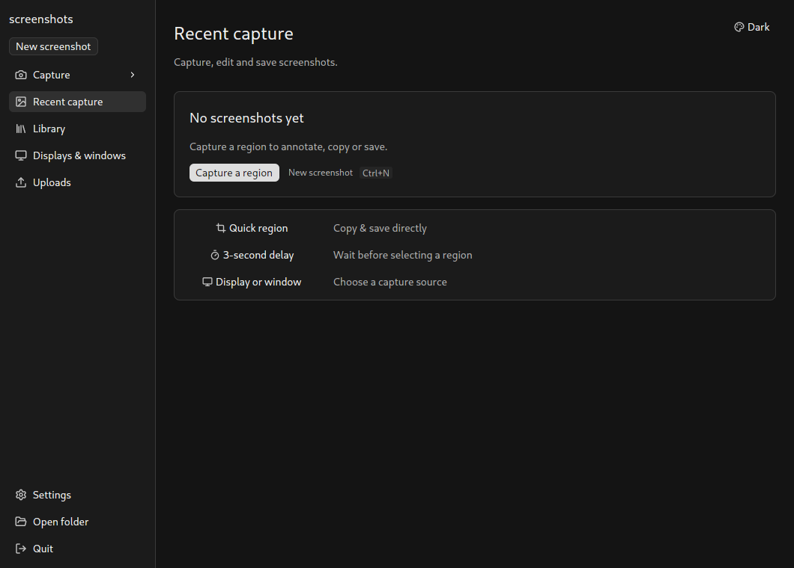
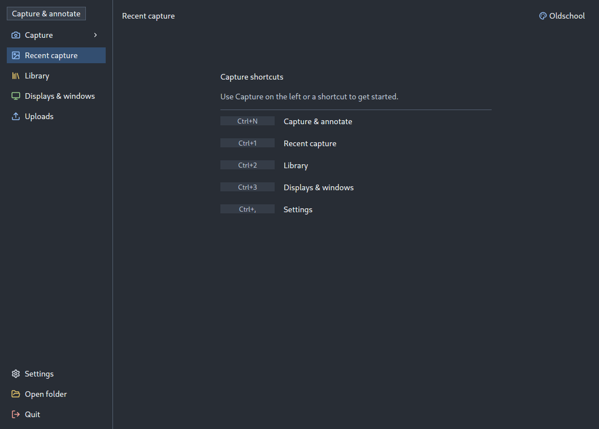
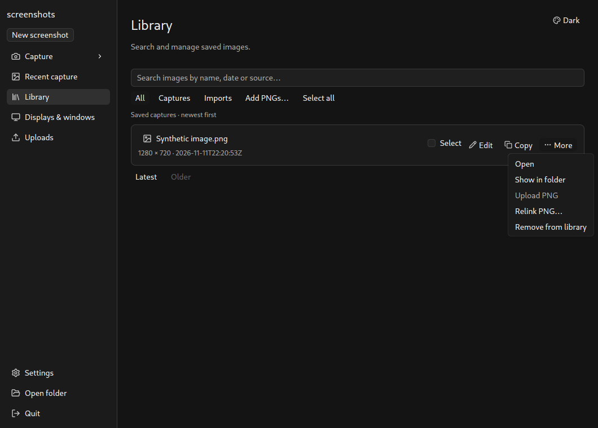
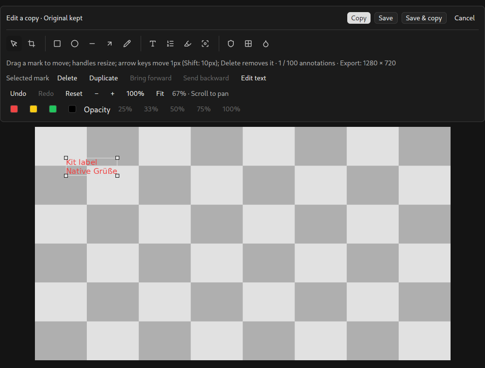

# GPUI Kit workspace rewrite

The full presentation layer now uses GPUI Kit 0.9.1 and its pinned GPUI 0.3.12
snapshot. Dark remains the minimal default; Oldschool retains compact navigation
and colorful function icons. The Rust capture/image/storage/upload core and its
explicit output/cancellation contracts are reused.

## Ownership

- `workspace.rs`: screen composition with Kit Sidebar, Button, Input, Checkbox,
  RadioGroup, PopupMenu and Kbd. Paged library rows use stable database identities.
- `window.rs`: every window has a Kit Base Root; native jobs address its typed
  content without bypassing the Root. Quit still waits for active work.
- `theme.rs`: product colors/density synchronized through Kit `Theme::update`.
- `assets.rs`: default Kit assets plus selected capture/editor Lucide icons.
- `redaction_editor.rs`: Kit controls around the existing in-memory image canvas.
- `caption.rs`: bounded document-label editing and native alpha-mask rasterization;
  its 512-byte/four-line admission and pixel geometry remain domain constraints.
- `app-core`: capture, image operations, SQLite, credentials, exports and uploads.

The application has one UI-framework dependency. Optional JavaScript extensions,
speech, syntax engines, profilers and capture streams are not enabled. Cargo.lock
freezes the matched dependency family. The previous Windows teardown safety fix
is ported to the new backend under `vendor/gpui-pre-windows`; its license and
provenance are retained.

## Behavior and verification

Kit owns keyboard/pointer/disabled/selection behavior, menu placement/dismissal,
input editing and window-level facilities. Library search is created at page entry
and released with its subscription at exit; obsolete jobs and popup commands are
rejected by revision/identity. Theme changes keep the existing background save
and rollback behavior. UI appearance does not change annotations or exported
pixels. Linux image-label fonts now resolve independently of the UI theme.

Headless Kit integration tests drive the production workspace: disabled capture,
keyboard navigation, search Unicode/byte bounds/Escape, scoped menu safety,
controlled checkbox state, transparent overlay surfaces, Escape cancellation and
waiting for work during Quit.

The opt-in native X11 probe drives only this application's windows and a synthetic
PNG. It covers the real menu, both appearances and persistence, compact layout,
multiline labels with Unicode, Save only, original preservation and normal Quit.
It never captures the desktop, uploads or copies image output to the clipboard.
Its native window events bypass OS mouse/keyboard injection.

To rerun it on Linux/X11, set `SCREENSHOTS_NATIVE_PROBE_ROOT` to an absolute path
and set `XDG_CONFIG_HOME`, `XDG_DATA_HOME` and `XDG_CACHE_HOME` beneath it. Unset
`WAYLAND_DISPLAY`, install ImageMagick, and run:

```sh
cargo test --locked -p app-ui native_probe::native_kit_workspace_and_editor -- --ignored --nocapture --test-threads=1
```

Machine-readable results, optimized observations and exact binary hashes are in
[ui-redesign-verification.json](ui-redesign-verification.json). Native screenshots
below are generated from the isolated probe, with metadata removed.

## Optimized resource comparison

Three interleaved launches per version used an empty 1060×760 production window
with isolated settings on the same Linux X11/XWayland session. Median process
private mappings were 216.0 MiB before and 226.7 MiB with Kit (+10.7 MiB, +5.0%).
Median short idle CPU samples were 0.20% of one core for both; 0–0.40% readings
and a five-second sample are too coarse for the five-minute idle gate. No sampled
physical disk I/O occurred. The release binary grew from 58.1 to 74.5 MiB.

Both versions exceed the existing 100 MiB visible-shell private-memory target on
this development host. These figures include private driver mappings; app-owned
GPU allocations were not isolated. The rewrite adds component/root/input/icon
facilities while keeping optional Kit runtimes off. This is a relative regression
check, not reference-hardware or full resource acceptance. Exact samples and the
compared binary hashes are in the verification JSON.

## Screenshots

| Dark | Oldschool |
| --- | --- |
|  |  |





## Limits

Native functional inspection here is Linux X11/XWayland. Windows receives a CI
compile check of the platform paths and opt-in native tests; interactive Windows,
macOS, mixed DPI, screen-reader acceptance and the full reference-hardware resource
budgets remain separate gates. No successful compile or headless test establishes
physical presentation/input latency or complete platform acceptance.
